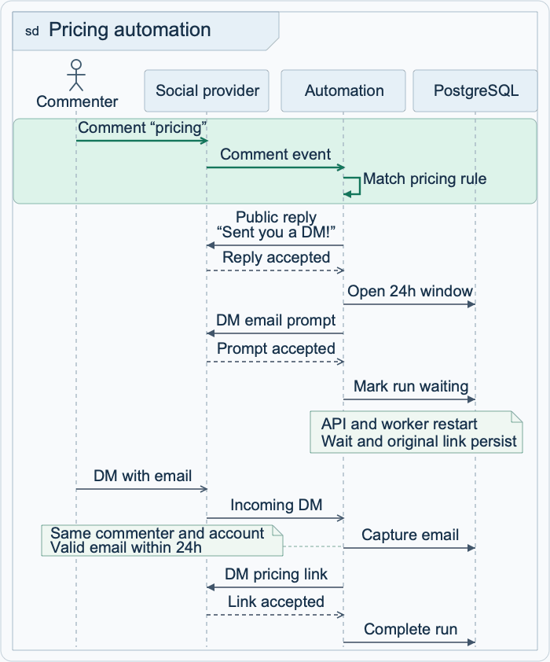
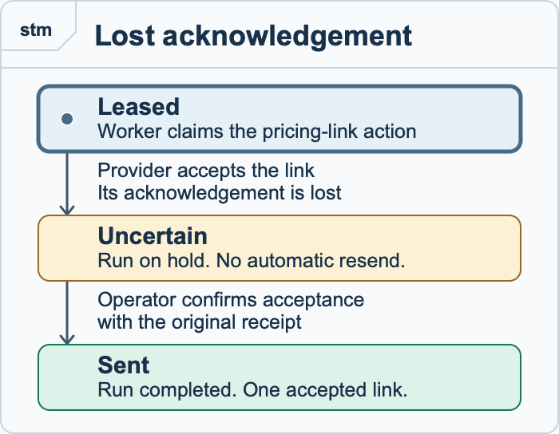

# Comment-triggered automations

[](https://github.com/ByAxe/blotato-comment-automations/actions/workflows/verify.yml)
[Latest release](https://github.com/ByAxe/blotato-comment-automations/releases/latest)

When someone comments **pricing** on an Instagram post, the automation replies publicly with **Sent you a DM!** and then asks for an email address in a private message. A valid reply from the same commenter within 24 hours triggers a DM with the configured pricing link.


[Architecture and UML](docs/diagrams.md) · [Production sizing and storage](docs/storage-and-sizing.md) · [Blotato product context](docs/product-context.md)

## Follow one conversation

<picture>
  <source media="(prefers-reduced-motion: reduce)" srcset="docs/assets/pricing-sequence.svg">
  
</picture>

The worker can stop while the commenter decides whether to reply. PostgreSQL keeps the waiting run and its original pricing link. A duplicate event cannot create a second link send.

Customers can also enable a history for each commenter on a connected account. It pairs recent comment and DM excerpts with the outcomes of the corresponding sends. A returning commenter can receive a different email prompt and still has to reply before the link goes out. [Participant context and retention](docs/participant-context.md)

<details>
<summary>Watch what happens when a send loses its acknowledgement</summary>

<picture>
  <source media="(prefers-reduced-motion: reduce)" srcset="docs/assets/uncertain-send.svg">
  
</picture>

In this example the operator finds the original receipt. To retry, the operator must establish that the first request had no effect, the old sender can no longer send, and the dispatch window is still open. [Recovery procedure](docs/delivery-recovery.md)

</details>

## Verify in Docker

From the repository root with Make and Docker Compose v2, run the same verification as CI.

```sh
make verify
```

The command creates a disposable PostgreSQL 17 environment, runs the tests and concurrent workloads, and removes the environment when it finishes. The HTTP test restarts the API and worker during the wait and checks that two concurrent replies produce one recorded link DM.

## Try the HTTP API

Start the API, delivery worker, PostgreSQL, and recording provider. The sandbox uses synthetic credentials and events.

```sh
make sandbox-up
make sandbox-demo
```

The walkthrough publishes the pricing rule, submits a comment and an email, then checks the three receipts at the provider. It uses the sandbox’s built-in account and credentials. [Run the pricing flow](docs/api.md#run-the-pricing-flow)

```sh
make sandbox-down
```

## Run individual checks

Use Node.js 22–24 and make PostgreSQL's `initdb` and `pg_ctl` available on your path. Run `npm ci` once. You can also point `PG_TEST_ADMIN_URL` at a dedicated PostgreSQL test server with permission to create and drop disposable databases.

| Command | What to look for |
| --- | --- |
| `npm test` | The full suite covers rule versions, event deduplication, send deadlines, recovery, and run statistics. |
| `npm run e2e` | The API and worker resume a waiting conversation across restarts with an HTTP recording provider. |
| `npm run demo` | A two-process trace shows the public reply, email prompt, durable wait, and one link after a duplicated email reply. |
| `npm run load` | The default workload checks 400 completed conversations and 1,200 accepted simulated sends under concurrent intake and delivery. [Host and timings](docs/capacity.md) |
| `npm run skew` | A quiet account receives its turn while another has a backlog, then makes progress during that account’s provider cooldown. |

These checks use synthetic events and simulated provider acceptance. Live Instagram delivery requires an authorized provider integration and separate verification. The load timings describe the test host and scenario. [Provider integration](docs/integration.md)

## Explore the implementation

| Start with | Go deeper |
| --- | --- |
| [Requirements and acceptance](docs/requirements.md) | The pricing rules, edge cases, and tests that exercise them. |
| [Architecture](docs/architecture.md) | [UML diagrams](docs/diagrams.md), [data model](docs/data.md), [module boundaries](docs/modularity.md), and [send recovery](docs/delivery-recovery.md). |
| [Verification and release](docs/release.md) | [Measured workloads](docs/capacity.md) and [latest release](https://github.com/ByAxe/blotato-comment-automations/releases/latest). |

## For contributors

Run `make help` to see the available commands. The contributor guide maps common changes to the relevant skills and checks. A developer can keep personal preferences and a handoff in a local profile. [Contributor guide](AGENTS.md) · [Skills and evals](evals/README.md) · [Developer profiles](docs/developer-context.md)
