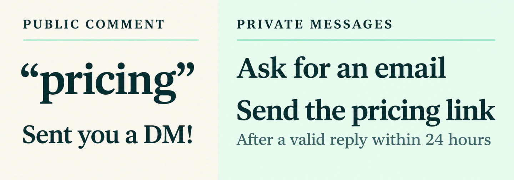

# Comment-triggered automations

[](https://github.com/ByAxe/blotato-comment-automations/actions/workflows/verify.yml)
[Latest release](https://github.com/ByAxe/blotato-comment-automations/releases/latest)

When someone comments **pricing** on an Instagram post, the automation replies publicly with **Sent you a DM!** and then asks for an email address in a private message. A valid reply from the same commenter within 24 hours triggers a DM with the configured pricing link.



PostgreSQL records each event, run, and outgoing action. A worker restart preserves the wait and the original link. Duplicate events do not create a second logical send. An uncertain send stays visible for reconciliation.

## Verify in Docker

From the repository root with Docker Compose v2, run the same verification job used in CI under an isolated project name.

```sh
docker compose -p comment-verify up --build --abort-on-container-exit --exit-code-from verify
```

The job runs the test suite, prints a conversation trace, and checks a small concurrent workload against PostgreSQL 17. The HTTP test restarts the API and worker during the wait and verifies that concurrent replies produce one recorded link DM.

Remove the disposable verification environment when finished.

```sh
docker compose -p comment-verify down --volumes
```

## Try the HTTP API

Start the API, delivery worker, PostgreSQL, and recording provider. The sandbox uses synthetic credentials and events.

```sh
docker compose -p comment-demo --profile sandbox up --build -d api worker
curl --fail --retry 10 --retry-connrefused --retry-delay 1 http://127.0.0.1:3030/healthz
```

The walkthrough publishes the pricing rule, submits a comment and an email, then checks the three receipts at the provider. It uses the sandbox’s built-in account and credentials. [Run the pricing flow](docs/api.md#run-the-pricing-flow)

```sh
docker compose -p comment-demo --profile sandbox down --volumes
```

## Run individual checks

Use Node.js 22–24 and make PostgreSQL's `initdb` and `pg_ctl` available on your path. Run `npm ci` once. You can also point `PG_TEST_ADMIN_URL` at a dedicated PostgreSQL test server with permission to create and drop disposable databases.

| Command | What to look for |
| --- | --- |
| `npm test` | The full suite covers rule versions, event deduplication, send deadlines, recovery, and run statistics. |
| `npm run e2e` | The API and worker resume a waiting conversation across restarts with an HTTP recording provider. |
| `npm run demo` | A two-process trace shows the public reply, email prompt, durable wait, and one link after a duplicated email reply. |
| `npm run load` | The default workload checks 400 completed conversations and 1,200 accepted simulated sends under concurrent intake and delivery. [Host and timings](docs/capacity.md) |

These checks use synthetic events and simulated provider acceptance. Live Instagram delivery requires an authorized provider integration and separate verification. The load timings describe the test host and scenario. [Provider integration](docs/integration.md)

## Explore the implementation

| Start with | Go deeper |
| --- | --- |
| [Requirements and acceptance](docs/requirements.md) | The pricing rules, edge cases, and tests that exercise them. |
| [Architecture](docs/architecture.md) | [System diagrams](docs/diagrams.md), [data model](docs/data.md), and [send recovery](docs/delivery-recovery.md). |
| [Verification harness](docs/harness.md) | [Agent workflow](docs/agent-workflow.md), [capacity and recovery](docs/capacity.md), and [release evidence](docs/release.md). |
