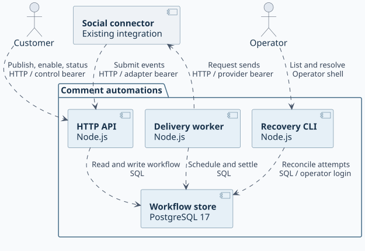
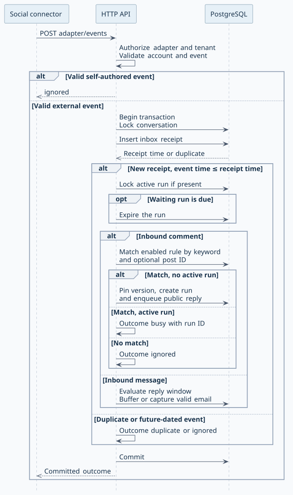
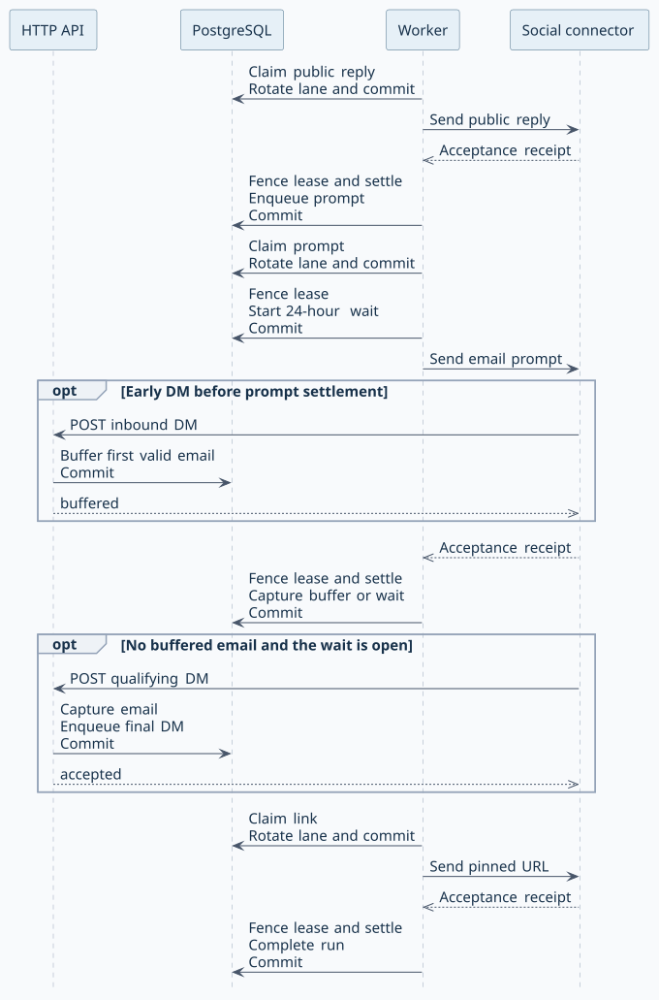
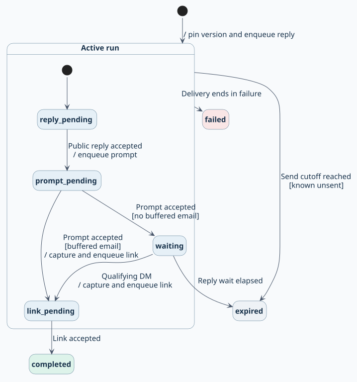
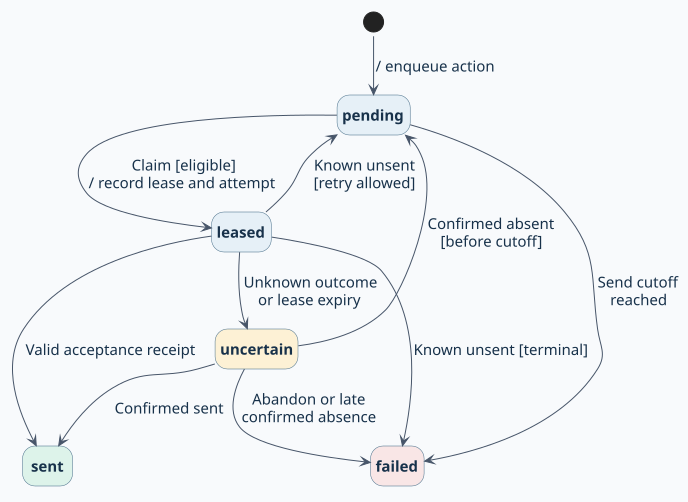

# Runtime architecture and workflow

A matching Instagram comment starts a pricing run. The worker sends the public reply `Sent you a DM!`, waits for its acceptance, then sends an email prompt. A qualifying response unlocks the last DM, which contains the URL from the configuration version the run pinned at creation.

## UML component diagram

[](diagrams/components.svg)

The package identifies the components owned by the automation system. Dashed arrows point from callers to the components they use. The HTTP API validates separate control and adapter bearer credentials, each bound to the configured tenant and account in the reference runtime. A production integration authenticates provider webhooks and derives account and participant identities before forwarding normalized events. In the local sandbox, a caller supplies synthetic inbound events and the recording provider simulates the outbound endpoint. Outbound calls use a separate bearer credential. Recovery runs through the operator CLI with database credentials and records PostgreSQL's `session_user`. [API and credential scopes](api.md) · [Provider integration](integration.md) · [Recovery procedure](delivery-recovery.md)

[Editable PlantUML source](diagrams/components.puml)

## UML sequence diagrams

### Ingestion transaction

[](diagrams/ingestion.svg)

For each validated external event, PostgreSQL takes the transaction lock for the tenant, account and participant before inserting the inbox receipt. Uniqueness on both the event ID and the pair of object kind and object ID protects against repeated envelopes and repeated objects within the tenant and account. A first receipt with a future provider timestamp is kept, and the event is ignored. The API checks the active run after those guards. A comment can start a run only when it matches the enabled keyword after trimming and lowercasing. It commits the new run and public reply together, and then returns the outcome. [Ingestion implementation](../src/workflow.ts) · [Operational schema](../db/001_core.sql)

[Editable PlantUML source](diagrams/ingestion.puml)

### Delivery and reply capture

[](diagrams/delivery-sequence.svg)

Each claim commits before the provider request. Provider I/O runs outside the transaction. Each worker settlement locks the leased action, checks the lease token and expiry, and commits the receipt together with any run transition or next action. The prompt claim opens a 24-hour reply wait. A DM must come from the same account and participant, contain one qualifying address, and satisfy the timestamp guard `prompt start ≤ occurred_at ≤ received_at < wait deadline`. The first qualifying email can be buffered while the prompt remains pending. The prompt settlement consumes it if present. Otherwise the API captures a qualifying email while the run is waiting. Capture and the final DM action commit together. [Workflow implementation](../src/workflow.ts) · [Delivery implementation](../src/delivery.ts)

| Boundary | Starts at | Governs |
| --- | --- | --- |
| Reply wait | Prompt claim | Inbound email correlation for 24 hours |
| Public reply and prompt send cutoff | Source comment creation | Provider dispatch before 168 hours |
| Final DM send cutoff | Accepted reply's provider timestamp | Provider dispatch before 24 hours |
| Worker lease | Each outbox claim | Authority to settle this attempt in PostgreSQL, 30 seconds by default |

The worker holds each action to its persisted exclusive `sendBefore`. The social connector checks the cutoff again at dispatch and applies any narrower provider rules. An acceptance receipt confirms provider acceptance. [Provider timing and permissions](integration.md) · [Delivery implementation](../src/delivery.ts)

[Editable PlantUML source](diagrams/delivery-sequence.puml)

## UML state machines

### Run lifecycle

[](diagrams/run-state.svg)

The run keeps its pinned version across configuration changes. An accepted prompt with no buffered email can immediately expire if the reply wait elapsed before settlement. A known-unsent action that hits its provider cutoff also expires the run. The other terminal delivery failures end it as `failed`. Both terminal delivery paths clear any buffered email. An uncertain action leaves the run in its active step until the attempt is resolved. [Workflow implementation](../src/workflow.ts) · [Operational schema](../db/001_core.sql)

[Editable PlantUML source](diagrams/run-state.puml)

### Outbox action lifecycle

[](diagrams/outbox-state.svg)

A claim is eligible when the action is due, its provider cutoff is open, and the account has no active cooldown. A confirmed transient non-send can requeue with backoff inside its attempt budget and dispatch window. Requeuing a prompt discards the buffered reply and closes its correlation window. A new claim opens a fresh one. A known-unsent action past the send cutoff has outbox status `failed` with reason `window_expired`, and the run becomes `expired`. [Delivery implementation](../src/delivery.ts) · [Delivery schema](../db/002_delivery.sql)

A worker that loses its lease cannot settle it. The lease sweeper moves overdue leases to `uncertain`, where the original cutoff alone cannot resolve the outcome. Recovery locks the same tenant, action and attempt, then commits the evidence and transition together. Confirmed sent requires a provider receipt. Confirmed absent requires evidence of non-acceptance and that the old dispatcher can no longer send. The CLI can authorize a new claim before the cutoff. [Recovery procedure](delivery-recovery.md)

[Editable PlantUML source](diagrams/outbox-state.puml)

The [UML class diagram and reporting view](data.md) show how these transitions are recorded and counted in the UTC start cohort.

## Regenerate the diagrams

Run this from the repository root with Java and the [PlantUML 1.2026.10 release JAR](https://github.com/plantuml/plantuml/releases/tag/v1.2026.10). The checked-in sources render with the embedded Smetana layout and the built-in sequence renderer.

```sh
java -Djava.awt.headless=true -jar /path/to/plantuml-1.2026.10.jar -failfast2 -tsvg -nometadata docs/diagrams/*.puml
```
